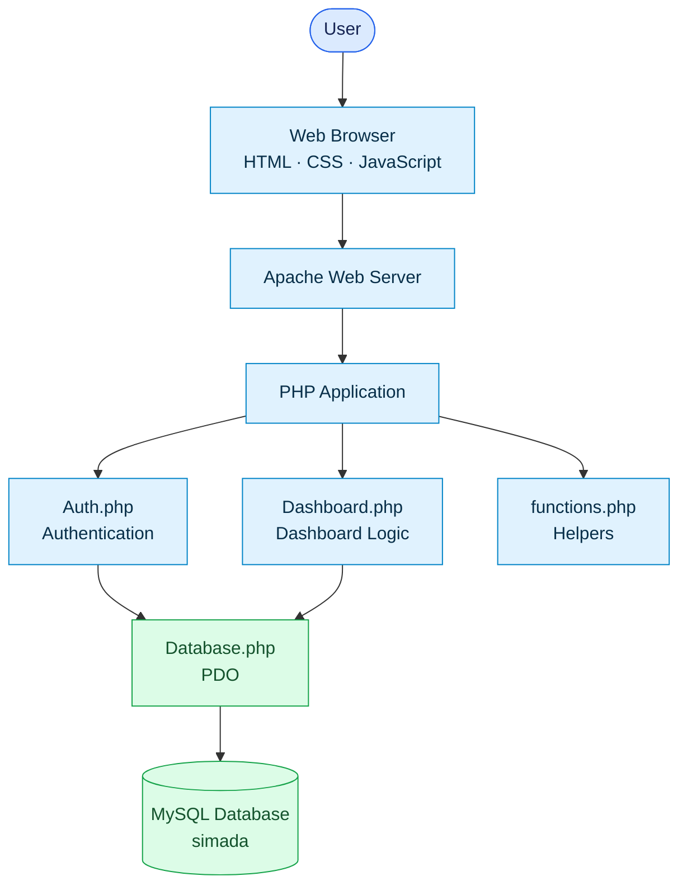

<div align="center">


<p>
  
  
  
  
  
  
</p>

**Aplikasi web untuk dashboard, pemantauan, dan pengelolaan informasi paket pengadaan.**

[Overview](#-project-overview) ·
[Features](#-core-features) ·
[Tech Stack](#-technology-stack) ·
[Architecture](#-system-architecture) ·
[Installation](#-installation) ·
[Database](#-database-structure)

</div>

---

## Project Overview

**SIMADA** adalah aplikasi berbasis web yang dirancang untuk mendukung proses pencatatan, pemantauan, serta penyajian informasi terkait paket pengadaan barang dan jasa di lingkungan Sekretariat Daerah Kabupaten Kebumen.

Pengembangan aplikasi ini dilakukan dalam bentuk prototype sebagai bagian dari pemenuhan tugas Ujian Tengah Semester (UTS) mata kuliah Rekayasa Perangkat Lunak. Implementasi sistem mencakup fitur dashboard pengadaan, pengelolaan paket, autentikasi pengguna, serta pembagian hak akses berdasarkan tiga peran pengguna (role).

> [!IMPORTANT]
> Versi ini merupakan prototype akademik dengan data simulasi. Aplikasi bukan pengganti SPSE/LPSE atau sistem resmi pengadaan pemerintah.

## Core Features

<div align="center">

|  |  |  |
|:--:|:--:|:--:|
| Ringkasan data pengadaan | Hak akses tiga role | Alur persetujuan paket |

</div>

| Modul | Deskripsi |
|---|---|
| **Role-Based Dashboard** | Menampilkan ringkasan dan informasi dashboard sesuai role pengguna. |
| **Procurement Overview** | Menyajikan daftar paket, kode RUP, OPD, metode, pagu, nilai kontrak, dan status. |
| **Package Management** | Mendukung alur pengelolaan informasi paket pengadaan. |
| **Approval Workflow** | Menyediakan proses persetujuan atau penolakan paket oleh PA/KPA. |
| **User Management** | Admin dapat menambahkan akun pengguna dan menetapkan role. |
| **Authentication** | Login menggunakan username atau email, logout, dan pengelolaan session. |
| **Dashboard Statistics** | Menyajikan ringkasan jumlah paket, anggaran, kontrak, status, OPD, dan metode pengadaan. |
| **Quick Search** | Pencarian paket berdasarkan kode RUP, nama paket, atau OPD pada dashboard. |

## User Roles

Aplikasi menggunakan tiga role utama:

| Role | Hak Akses Utama |
|---|---|
| **Admin** | Melihat ringkasan dashboard dan mengelola akun pengguna. |
| **PA/KPA** | Melihat informasi paket dan menangani antrean otorisasi/persetujuan paket. |
| **PPK** | Melihat serta mengelola paket yang menjadi tanggung jawabnya. |

**Pembatasan akses:** menu pengelolaan dan penambahan pengguna hanya tersedia untuk Admin. PA/KPA dan PPK tidak memiliki fitur untuk menambahkan pengguna.

## Technology Stack

| Komponen | Teknologi | Penggunaan |
|---|---|---|
| Backend | PHP Native | Logika aplikasi dan pemrosesan server-side. |
| Programming Paradigm | Object-Oriented Programming (OOP) | Pemisahan fungsi aplikasi ke dalam class. |
| Frontend | HTML5 | Struktur halaman aplikasi. |
| Styling | CSS3 | Tata letak, komponen, dan tampilan antarmuka. |
| Client-side | JavaScript | Interaksi antarmuka, termasuk pencarian dashboard. |
| Database | MySQL / MariaDB | Penyimpanan data aplikasi. |
| Database Access | PDO | Koneksi dan eksekusi query database. |
| Web Server | Apache | Menjalankan aplikasi PHP. |
| Local Environment | XAMPP | Lingkungan pengembangan lokal. |
| Database Administration | phpMyAdmin | Membuat database dan mengimpor SQL. |
| Version Control | Git | Pengelolaan versi source code. |

> Project menggunakan **PHP Native OOP**, bukan Laravel atau framework PHP lainnya.

## System Architecture

Aplikasi disusun dengan pemisahan tanggung jawab sederhana antara antarmuka, class aplikasi, helper, konfigurasi, dan database.



### Main Application Classes

| Class | File | Tanggung Jawab |
|---|---|---|
| `Database` | `classes/Database.php` | Mengelola koneksi PDO ke MySQL menggunakan pola Singleton serta menyediakan fungsi query. |
| `Auth` | `classes/Auth.php` | Menangani login, logout, session, identifikasi role, dan pembuatan akun pengguna. |
| `Dashboard` | `classes/Dashboard.php` | Mengambil data paket dan menghitung statistik dashboard, komposisi metode, serta informasi persetujuan. |

### Request Flow

1. Pengguna membuka aplikasi melalui browser.
2. Apache meneruskan request ke file PHP.
3. `config.php` memulai session, memuat konfigurasi, class, dan helper.
4. Class aplikasi menjalankan autentikasi atau proses dashboard sesuai kebutuhan.
5. `Database.php` mengakses MySQL menggunakan PDO.
6. Hasil pemrosesan ditampilkan kembali melalui halaman web.

## Project Structure

Struktur berikut mengikuti direktori source code yang tersedia pada repository:

```text
ujianrpl/
│
├── assets/
│   ├── css/
│   │   └── style.css
│   └── img/
│       └── logo-simada.png
│
├── classes/
│   ├── Auth.php
│   ├── Dashboard.php
│   └── Database.php
│
├── helpers/
│   └── functions.php
│
├── DB_sql/
│   └── simada.sql
│
├── test/
│   ├── bootstrap.php
│   └── run.php
│
├── config.php
├── dashboard.php
├── index.html
├── index.php
├── login.php
├── logout.php
├── tambah-user.php
└── README.md
```

<details>\n<summary><strong>📂 Lihat penjelasan direktori dan file</strong></summary>\n\n### Directory and File Description\n\n| Path | Deskripsi |
|---|---|
| `assets/css/` | File stylesheet utama aplikasi. |
| `assets/img/` | Logo dan aset gambar SIMADA. |
| `classes/` | Class PHP untuk autentikasi, dashboard, dan database. |
| `helpers/` | Fungsi bantuan yang digunakan oleh halaman aplikasi. |
| `DB_sql/` | Direktori file SQL database. |
| `DB_sql/simada.sql` | Struktur tabel, view, relasi, dan data awal database. |
| `test/` | Bootstrap dan script pengujian aplikasi. |
| `config.php` | Konfigurasi database, session, autoload class, dan helper. |
| `index.php` | Entry point aplikasi. |
| `index.html` | Halaman HTML statis. |
| `login.php` | Halaman autentikasi pengguna. |
| `logout.php` | Proses mengakhiri session pengguna. |
| `dashboard.php` | Halaman dashboard berdasarkan role. |
| `tambah-user.php` | Halaman penambahan dan daftar akun pengguna. |
| `README.md` | Dokumentasi project. |\n\n</details>

## Database Structure

Database aplikasi menggunakan nama **`simada`** dan didefinisikan pada file `DB_sql/simada.sql`.

<details open>\n<summary><strong>🗃️ Detail tabel database</strong></summary>\n\n### Tables\n\n| No. | Nama Tabel | Keterangan |
|:--:|---|---|
| 1 | `role` | Data role atau jenis hak akses pengguna. |
| 2 | `user` | Akun dan informasi pengguna. |
| 3 | `opd` | Data Organisasi Perangkat Daerah. |
| 4 | `procurement_method` | Referensi metode pengadaan. |
| 5 | `procurement_package` | Data utama paket pengadaan. |
| 6 | `package_personnel` | Relasi personel dengan paket pengadaan. |
| 7 | `progress` | Informasi perkembangan paket. |
| 8 | `document` | Metadata dokumen paket. |
| 9 | `notification` | Data notifikasi. |
| 10 | `audit_log` | Catatan aktivitas sistem. |
| 11 | `approvals` | Data keputusan persetujuan paket. |\n\n</details>

### Database Views

Selain tabel, SQL project juga mendefinisikan view:

- `packages`
- `users`

View digunakan sebagai sumber data untuk kebutuhan query aplikasi. Tabel penyimpanan utama paket adalah `procurement_package`, sedangkan `packages` merupakan view.

### Simplified Entity Relationship

```text
role
  |
  | 1..*
  v
user ----------------------+
  |                        |
  | PPK                    | activity / approval
  v                        v
procurement_package      audit_log
  |
  +----------+-------------+-------------+
  |          |             |             |
  v          v             v             v
progress  document    notification   approvals

opd ----------------> procurement_package
procurement_method --> procurement_package

user <-------------> procurement_package
          package_personnel
```

Relasi konseptual di atas merangkum entitas yang tersedia. Detail foreign key dan kolom tetap mengacu pada definisi di `DB_sql/simada.sql`.

## Dashboard Information

Dashboard menyajikan ringkasan informasi pengadaan, antara lain:

- Jumlah paket pengadaan.
- Total pagu anggaran.
- Total nilai kontrak.
- Jumlah paket berdasarkan status.
- Tingkat penyelesaian paket.
- Komposisi metode pengadaan.
- Ringkasan paket berdasarkan OPD.
- Daftar paket terbaru dan antrean tindakan sesuai role.

Informasi yang ditampilkan dibatasi oleh role dan data yang tersedia pada database simulasi.

## Installation

### Requirements

- Windows, Linux, atau macOS.
- XAMPP atau lingkungan server setara.
- PHP **8.0 atau lebih baru**.
- Apache.
- MySQL atau MariaDB.
- Ekstensi PHP PDO MySQL.
- Browser modern.

### 1. Download Project

Clone repository:

```bash
git clone https://github.com/CodeCrafter-FourR/SIMADA.git
```

Atau unduh source code sebagai ZIP dari GitHub, lalu ekstrak ke folder web server.

Contoh lokasi XAMPP:

```text
C:\xampp\htdocs\ujianrpl
```

### 2. Start Apache and MySQL

1. Buka XAMPP Control Panel.
2. Jalankan **Apache**.
3. Jalankan **MySQL**.

### 3. Create Database

Buka phpMyAdmin:

```text
http://localhost/phpmyadmin
```

Buat database baru bernama:

```text
simada
```

### 4. Import Database

1. Pilih database `simada`.
2. Buka tab **Import**.
3. Pilih file `DB_sql/simada.sql`.
4. Jalankan proses import.
5. Pastikan tabel dan view berhasil dibuat.

### 5. Configure Database Connection

Buka file `config.php`. Konfigurasi default yang digunakan:

```php
define('DB_HOST', 'localhost');
define('DB_NAME', 'simada');
define('DB_USER', 'root');
define('DB_PASS', '');
define('DB_CHARSET', 'utf8mb4');
```

Sesuaikan nilai konfigurasi jika username atau password MySQL pada komputer berbeda.

### 6. Run the Application

Buka browser:

```text
http://localhost/ujianrpl/
```

Jika halaman utama tidak terbuka, coba akses:

```text
http://localhost/ujianrpl/login.php
```

## Demo Accounts

Database SQL menyediakan akun simulasi untuk pengujian. Akun yang digunakan dalam demonstrasi project:

| Role | Username | Password |
|---|---|---|
| Admin | `admin` | `password` |
| PA/KPA | `pakpa` | `password` |
| PPK | `ppk1` | `password` |

> [!WARNING]
> Kredensial di atas merupakan akun demo untuk kebutuhan akademik. Ganti password dan jangan gunakan akun tersebut pada server produksi.

## Testing

Project menyediakan script pengujian pada direktori `test/`.

File pengujian:

- `test/bootstrap.php` — menyiapkan koneksi dan kebutuhan lingkungan pengujian.
- `test/run.php` — menjalankan rangkaian pengujian.

Pengujian menggunakan database terpisah bernama `simada_test` agar data utama tidak tercampur dengan data pengujian.

Contoh menjalankan test melalui terminal dari direktori project:

```bash
php test/run.php
```

Pastikan database pengujian sudah dibuat dan konfigurasi bootstrap sesuai sebelum menjalankan script. Hasil pengujian perlu diperiksa langsung pada lingkungan lokal.

## Security Notes

Implementasi project mencakup beberapa mekanisme dasar:

- Password diverifikasi menggunakan `password_verify()` dan dibuat menggunakan `password_hash()` dengan algoritma Bcrypt.
- Query database menggunakan PDO prepared statements.
- Session login diregenerasi setelah autentikasi berhasil.
- Output halaman menggunakan helper escaping untuk membantu mencegah output HTML yang tidak aman.
- Akses halaman dashboard memerlukan session login.

Untuk penggunaan di lingkungan produksi, masih diperlukan peninjauan keamanan lebih lanjut, termasuk penguatan otorisasi per aksi, proteksi CSRF, pengaturan cookie session, validasi input, dan pengelolaan kredensial.

## Current Scope and Limitations

Versi project ini difokuskan pada kebutuhan prototype UTS, yaitu:

- Dashboard pengadaan (UC-08).
- Tiga role pengguna: Admin, PA/KPA, dan PPK.
- Pengelolaan akun oleh Admin.
- Pengelolaan dan pemantauan paket sesuai role.
- Alur persetujuan paket oleh PA/KPA.
- Database MySQL dengan data simulasi.

Integrasi dengan sistem eksternal, seperti SPSE/LPSE, SIRUP, WhatsApp API, email gateway, dan tanda tangan elektronik, **tidak dinyatakan sebagai fitur aktif pada versi project ini**.

## Repository Information

| Item | Detail |
|---|---|
| Project | SIMADA |
| Organization Context | Sekretariat Daerah Kabupaten Kebumen |
| Application Type | Web Application |
| Backend | PHP Native OOP |
| Database | MySQL / MariaDB |
| Local Server | XAMPP / Apache |
| Project Purpose | UTS — Rekayasa Perangkat Lunak |
| Repository | [CodeCrafter-FourR/SIMADA](https://github.com/CodeCrafter-FourR/SIMADA) |

---

<div align="center">


**SIMADA — Sistem Informasi Pengadaan Barang/Jasa Kabupaten Kebumen**

_Dikembangkan sebagai prototype akademik untuk mendukung pengelolaan dan pemantauan informasi pengadaan._

<sub>Built with PHP Native OOP · MySQL · Apache</sub>

</div>
